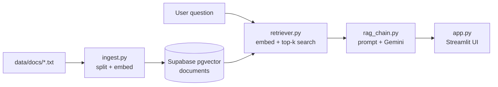

# RAG Knowledge Base

A retrieval-augmented Q&A app over AI engineering concepts. Ask a question, and the app retrieves the most relevant passages from a small corpus stored in Supabase pgvector, then has Gemini answer using only that context.

Covers RAG, embeddings and vector search, prompt engineering, RAG evaluation, LLMOps and observability, and AI agents.

## Features

- Document ingestion: chunks text files, embeds them with Voyage AI, and stores them in Supabase pgvector.
- Semantic retrieval: returns the top-k most similar chunks for each question.
- Grounded answers: Gemini answers only from retrieved context and says so when the context lacks the answer.
- Streamlit UI: question box, sample questions, and expandable source chunks for every answer.

## How it works



| Component | Role |
| --- | --- |
| Voyage AI (`voyage-3`) | Text embeddings (1024 dimensions) |
| Supabase pgvector | Vector storage and similarity search |
| LangChain | Loaders, text splitting, retriever, LCEL chain |
| Google Gemini (`gemini-3.5-flash`) | Answer generation |
| Streamlit | Web UI |

## Prerequisites

- Python 3.11
- A Supabase project with pgvector enabled and a `documents` table plus `match_documents` function. See the [LangChain Supabase vector store guide](https://python.langchain.com/docs/integrations/vectorstores/supabase/) for the setup SQL. The `documents` table needs an `embedding` column of type `vector(1024)`.
- API keys for [Voyage AI](https://www.voyageai.com/), [Google AI Studio](https://aistudio.google.com/), and Supabase.

## Quick start

```bash
git clone https://github.com/tuahung248/rag-knowledge-base.git
cd rag-knowledge-base

python -m venv .venv
source .venv/bin/activate
pip install -r requirements.txt

cp .env.example .env   # then fill in your keys

python src/ingest.py   # load the corpus into Supabase
streamlit run app.py   # open the UI at http://localhost:8501
```

## Configuration

Copy `.env.example` to `.env` and set:

| Variable | Description |
| --- | --- |
| `GEMINI_API_KEY` | Google AI Studio key for Gemini |
| `VOYAGE_API_KEY` | Voyage AI key for embeddings |
| `SUPABASE_URL` | Your project URL |
| `SUPABASE_SERVICE_KEY` | Service role key, used server-side only |

> [!WARNING]
> The service role key bypasses Row Level Security. Keep it in `.env` and never ship it to browser code. `.env` is gitignored.

> [!IMPORTANT]
> Ingestion and retrieval must use the same embedding model. Both scripts use `voyage-3`. If you change one, change the other and re-run `ingest.py`.

## Usage

### Ingest the corpus

```bash
python src/ingest.py
```

Reads every `.txt` file in `data/docs/`, splits it into 500-character chunks with 50-character overlap, and replaces the contents of the `documents` table. Re-running is safe: the table is cleared before inserting.

### Ask questions from the command line

```bash
python -m src.rag_chain
```

Runs the sample questions in `src/rag_chain.py` and prints each answer.

### Run the web app

```bash
streamlit run app.py
```

> [!TIP]
> Click a sample question in the sidebar to fill the input, then press **Ask**. Expand **Sources** under an answer to see the retrieved chunks.

## Project structure

```
.
├── app.py                 # Streamlit UI
├── data/docs/             # Corpus: plain-text AI engineering notes
├── src/
│   ├── ingest.py          # Chunk, embed, and store documents
│   ├── retriever.py       # Top-k similarity search over pgvector
│   └── rag_chain.py       # LCEL chain: retriever → prompt → Gemini
├── .env.example           # Required environment variables
└── requirements.txt
```

## Adding documents

Drop a new `.txt` file into `data/docs/` and run `python src/ingest.py`. The whole table is rebuilt from the corpus on each run.
